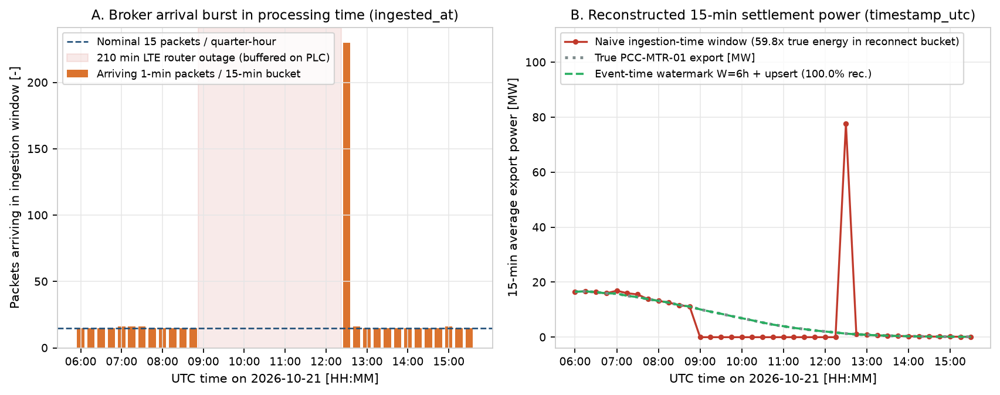
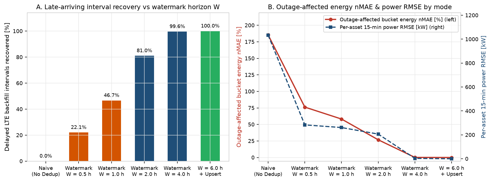
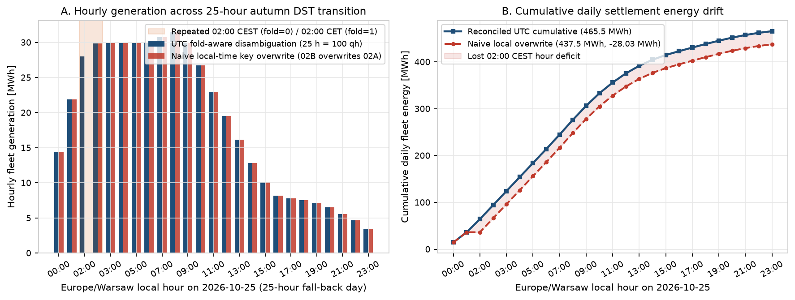
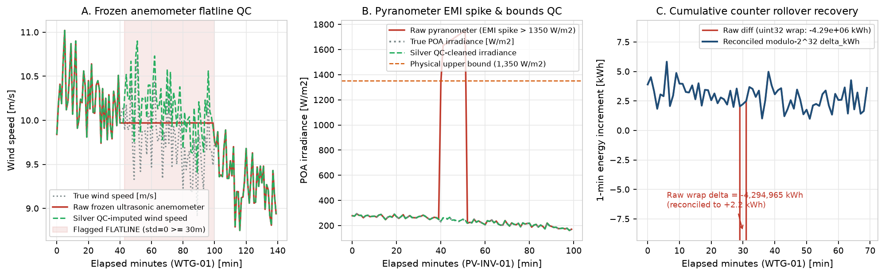

# Streaming SCADA telemetry, late-arriving backfill and Medallion lakehouse (Parquet, TimescaleDB DDL)

[](https://github.com/kwwaleszczynski-del/scada-lakehouse-streaming/actions/workflows/ci.yml)

Field SCADA telemetry from wind farms, PV plants and point-of-common-coupling (PCC) revenue meters rarely reaches the
broker as a clean 1-minute clock. Cellular LTE routers at remote substations drop out while the PLC or RTU buffers
1-minute registers and flushes the backlog in one burst on reconnect; MQTT QoS 1 delivery is at-least-once, so packets
can arrive twice (OASIS MQTT Version 5.0, section 4.3.2; to be verified); legacy loggers export local `Europe/Warsaw`
timestamps across 23-hour and 25-hour DST days; and field sensors freeze, spike or roll their energy counters over.

This repository simulates those failure modes on a synthetic `50 MW` hybrid fleet and measures what each one does to
15-minute settlement data, comparing naive handling with an event-time **Bronze -> Silver -> Gold** pipeline.

**Scope**

- All data are synthetic and seeded (`seed=42`): 7 days (19 to 25 October 2026) of 1-minute telemetry for `10 x 3.0 MW`
  wind turbines `WTG-01..10`, `4 x 5.0 MW` PV inverters `PV-INV-01..04` and `2` PCC meters (`161,280` true
  asset-minutes). Outage schedule, duplicate rate and sensor faults are simulator inputs; every result below is computed
  by the pipeline from the simulated Bronze stream against the simulator's ground truth.
- No MQTT/Kafka broker and no database run here. Broker arrival times (`ingested_at`) are simulated, and the pipeline is
  a pandas batch replay of the arrival log.
- `results/timescaledb_schema.sql` is generated DDL text. It is **not executed** by this repository or its CI; the
  TimescaleDB calls follow the TimescaleDB 2.x documentation and are to be verified on a live instance.
- The Gold performance ratio borrows its definition from IEC 61724-1 without temperature correction, and the wind power
  curve is a synthetic cubic curve; neither is a conformant IEC implementation (to be verified against the standards).

**Interactive dashboard:** https://kwwaleszczynski-del.github.io/scada-lakehouse-streaming/

## Key results

All numbers come from `python -m scada_lakehouse` (files in `results/`). The tests recompute each metric independently
and check that the committed CSV files match a fresh run.

The main result is the watermark trade-off. Event-time bucketing that drops packets arriving more than $`W`$ after
their PLC timestamp keeps this share of the `2,130` asset-minutes delayed by the `18` LTE outages
(`results/ingestion_benchmark.csv`):

| Watermark $`W`$ | `0.5 h` | `1.0 h` | `2.0 h` | `4.0 h` | `6.0 h` |
|---|---:|---:|---:|---:|---:|
| Delayed minutes recovered | `22.07 %` | `46.67 %` | `81.03 %` | `99.62 %` | `100.00 %` |

A shorter watermark closes each quarter-hour sooner but drops the tail of the longer outages. The longest simulated
arrival lag is `4.21 h`, so any $`W`$ above it keeps every delayed minute.

| Failure mode | Naive handling | Event-time pipeline |
|---|---:|---:|
| Energy in the reconnect quarter-hour vs truth (median over `18` LTE outages) | `9.19x` (range `3.73x` to `59.81x`) | `1.00x` at every $`W`$ (by construction: event time never moves the backlog into this bucket) |
| Energy error in outage-affected quarter-hours (nMAE) | `185.40 %` | `0.00 %` at `W = 6 h`, by construction: `6 h` exceeds the longest lag of `4.21 h` (`0.12 %` at `W = 4 h`) |
| QoS-1 duplicate energy counted | `1.97 %` of true energy | `0.00 %` |
| Fleet energy on the 25-hour DST day (25 October 2026) | `-28.028 MWh` (`-6.02 %`) | `0.000 MWh`, `100.00 %` of rows on their true UTC minute |

The rule-based Silver data quality (DQ) checks reach a macro-F1 of `0.986` on faults injected by the same simulator;
section 3 explains why that is a consistency check rather than an accuracy estimate.

### 1. Event-time watermarking vs naive ingestion-time windowing across 18 LTE outages

The Bronze log holds `164,183` packets: `161,280` true asset-minutes plus `2,903` QoS-1 duplicate retries (`1.80 %`,
simulator input). The `18` outages last `45` to `240` minutes and delay `2,130` asset-minutes; the longest arrival lag
is `4.21 h` (`results/ingestion_benchmark.csv`, `results/reconnect_bursts.csv`).

| Ingestion mode | Watermark $`W`$ | Completeness | Delayed minutes recovered | Duplicate energy counted | Reconnect-bucket energy ratio (median) | Outage-affected energy nMAE | Per-asset 15-min power RMSE |
|---|---:|---:|---:|---:|---:|---:|---:|
| Naive ingestion-time (`ingested_at`, no dedup) | none | `98.68 %` | `0.00 %` | `1.97 %` | `9.19x` | `185.40 %` | `1,033.86 kW` |
| Event-time, drop late `> W` | `0.5 h` | `98.97 %` | `22.07 %` | `0.00 %` | `1.00x` | `76.21 %` | `283.27 kW` |
| Event-time, drop late `> W` | `1.0 h` | `99.30 %` | `46.67 %` | `0.00 %` | `1.00x` | `58.16 %` | `261.19 kW` |
| Event-time, drop late `> W` | `2.0 h` | `99.75 %` | `81.03 %` | `0.00 %` | `1.00x` | `26.76 %` | `206.39 kW` |
| Event-time, drop late `> W` | `4.0 h` | `100.00 %` | `99.62 %` | `0.00 %` | `1.00x` | `0.12 %` | `3.38 kW` |
| Event-time + idempotent upsert | `6.0 h` | `100.00 %` | `100.00 %` | `0.00 %` | `1.00x` | `0.00 %` | `0.00 kW` |

How to read the table:

- **Completeness** is the share of true asset-minutes summed into their own event-time quarter-hour. Naive bucketing
  misplaces exactly the delayed minutes; at `W = 4 h` the missing `0.38 %` of delayed minutes (the first minutes of the
  240-minute outage `OUT-11`, whose lag exceeds 4 h) is too small to move completeness off `100.00 %` at two decimals.
- **Reconnect-bucket energy ratio:** for each outage, take the quarter-hour that receives most of the buffered backlog
  and divide the energy summed there by its true energy. In this simulation every outage ends on a quarter-hour boundary
  and flushes in under 15 minutes, so the whole backlog lands in one bucket. The ratio grows with outage length and
  when generation falls during the outage: `OUT-06` (210-minute outage of the wind-feeder PCC meter) reaches `59.81x`
  because its reconnect quarter-hour truly held only `324.8 kWh`.
- **Outage-affected energy nMAE** covers the quarter-hours inside an outage plus the ones its backlog lands in.
  Naive handling is wrong twice there: the outage buckets read zero and the reconnect bucket carries the backlog.
- Every event-time mode deduplicates on `(asset_id, timestamp_utc)`, so duplicate energy is already `0.00 %` at
  `W = 0.5 h`. With `W = 6 h` nothing is late (longest lag `4.21 h`), so here the upsert only collapses retries;
  it would also merge packets arriving later than `W`.





### 2. Central European (`Europe/Warsaw`) DST transition reconciliation

Legacy SFTP CSV exports carry naive local timestamps. On the 25-hour autumn day `02:00..02:59` occurs twice
(`02A` in CEST `UTC+2`, then `02B` in CET `UTC+1`); on the 23-hour spring day it does not exist
(`results/dst_reconciliation.csv`):

| DST transition date | Regime | Expected quarter-hours | Naive local-key quarter-hours | Reconciled UTC quarter-hours | Rows on true UTC minute | Naive daily energy error | Reconciled error |
|---|---|---:|---:|---:|---:|---:|---:|
| `2026-10-25` | Autumn fall-back (`CEST -> CET`, 25 h day) | `100` | `96` (`02B` overwrites `02A`) | `100` | `100.00 %` | `-28.028 MWh` (`-6.02 %`) | `0.000 MWh` |
| `2026-03-29` | Spring forward (`CET -> CEST`, 23 h day) | `92` | `96` (phantom `02:00` hour) | `92` | `100.00 %` | `+16.737 MWh` (`+4.91 %`) | `0.000 MWh` |

- October uses the simulated fleet's 14 generating units (PCC meters excluded). Naive deduplication on the local
  timestamp keeps the second `02:xx` row and loses `4` of `100` quarter-hours; they carry `6.02 %` of the day's energy
  because that night hour is above the day's hourly average.
- March is outside the simulated week, so it uses a separate synthetic fleet profile (`14.8 MW +/- 3.2 MW` sine) plus
  60 phantom `02:xx` rows (copies of the following hour) of the kind a naive 24-hour local grid creates.
- Once no row is dropped, the daily energy error is zero by construction; the stronger check is that every row maps
  back to its true UTC minute (`fold=0` for the first `02:xx` occurrence per asset, `fold=1` for the second, ordered
  by the monotonic `kWh_total` register).
- Transition dates follow the EU summer-time rule (last Sunday of March and of October at 01:00 UTC, Directive
  2000/84/EC; to be verified) as encoded in the IANA tz database used by Python `zoneinfo`.



### 3. Bronze -> Silver data quality rules vs injected faults

Evaluated across the `161,280` deduplicated asset-minutes, `769` of which carry an injected fault
(`results/dq_confusion_summary.csv`):

| Class | Rule | Support | TP | FP | FN | Precision | Recall | F1 |
|---|---|---:|---:|---:|---:|---:|---:|---:|
| `HEALTHY` | no rule fires | `160,511` | `160,511` | `35` | `0` | `0.9998` | `1.0000` | `0.9999` |
| `FLATLINE` | wind or POA reading unchanged for `>= 30 min` while active | `500` | `476` | `0` | `24` | `1.0000` | `0.9520` | `0.9754` |
| `SPIKE_OR_BOUNDS` | POA `> 1,350 W/m2`, POA `> 35 W/m2` with sun below `-4 deg`, wind `> 38 m/s`, power `> 1.08 P_rated` | `101` | `95` | `0` | `6` | `1.0000` | `0.9406` | `0.9694` |
| `COUNTER_RESET` | negative `kWh_total` step (`uint32` wrap or PLC zero reset) | `8` | `8` | `0` | `0` | `1.0000` | `1.0000` | `1.0000` |
| `CROSS_SENSOR_MISMATCH` | power `> 0.6 P_rated` with wind `< 2.5 m/s` or POA `< 40 W/m2` | `160` | `155` | `0` | `5` | `1.0000` | `0.9688` | `0.9841` |
| **Macro average** | | | | | | `1.0000` | `0.9723` | **`0.986`** |

The faults are injected by the same simulator the rules were written for, so these scores check that the rules do what
they say, not how they would perform on field data. All `35` misses fall in the first three minutes of an injected
window (asserted by `test_16`): `24` are the flatline rule's 3-minute warm-up across `8` flatline windows, and `11` are
onset minutes that the simulator places just inside a threshold (for example `1,335 W/m2` against the `1,350 W/m2`
bound). No healthy minute is flagged.



## Method

### 1. Event-time watermarking vs processing-time windowing

Each telemetry packet $`m`$ emitted by asset $`a`$ carries an acquisition timestamp $`t_{\text{utc}}(m)`$ stamped by
the PLC clock and a broker arrival timestamp $`t_{\text{ing}}(m) = t_{\text{utc}}(m) + \Delta t_{\text{net}}(m)`$.
During an LTE drop over $`[t_0, t_0 + D]`$, packets accumulate on the RTU and arrive in a reconnect burst at
$`t_{\text{ing}} \in [t_0 + D, t_0 + D + \tau_{\text{flush}}]`$:

```math
\hat{E}_{a,k}^{\text{naive}} = \sum_{m \,:\, t_{\text{ing}}(m) \in B_k} \Delta E(m), \qquad
\hat{E}_{a,k}^{\text{silver}} = \sum_{t_{\text{utc}} \in B_k} \Delta E^{\star}_{a}(t_{\text{utc}})
```

where $`B_k = [t_k, t_k + 15\text{ min})`$ and $`\Delta E^{\star}_{a}(t_{\text{utc}})`$ is the deduplicated Silver
record (idempotent upsert on `(asset_id, timestamp_utc)`). Drop-late modes discard packets with
$`t_{\text{ing}} - t_{\text{utc}} > W`$. For outage $`j`$ with reconnect quarter-hour $`k_j`$ (the bucket receiving
most of its backlog) and the set $`\mathcal{A}`$ of quarter-hours inside an outage or receiving its backlog:

```math
r_j = \frac{\hat{E}_{a_j,k_j}}{E_{a_j,k_j}}, \qquad
\mathrm{nMAE} = \frac{\sum_{(a,k) \in \mathcal{A}} \lvert \hat{E}_{a,k} - E_{a,k} \rvert}{\sum_{(a,k) \in \mathcal{A}} E_{a,k}}
```

### 2. Modulo-$`2^{32}`$ cumulative energy counter recovery

The simulated meters and inverter PLCs accumulate active energy in a 32-bit unsigned pulse register, assumed to scale at
$`w_p = 0.001\text{ kWh/pulse}`$, so it wraps at $`M_{32} = 2^{32} \times 10^{-3} = 4,294,967.296\text{ kWh}`$. For raw
register difference $`\Delta C_t = C_t - C_{t-1}`$ and maximum physically possible 1-minute export
$`\Delta E_{\max} = 1.15 \, P_{\text{rated}} / 60`$:

```math
\Delta E_t^{\text{rec}} =
\begin{cases}
\Delta C_t & 0 \le \Delta C_t \le \Delta E_{\max} \\[1ex]
\Delta C_t + M_{32} & \Delta C_t < 0 \text{ and } 0 \le \Delta C_t + M_{32} \le \Delta E_{\max} \quad (\text{uint32 rollover}) \\[1ex]
C_t & \Delta C_t < 0 \text{ and } 0 \le C_t \le \Delta E_{\max} \quad (\text{PLC zero-reset}) \\[1ex]
P_t / 60 & \text{otherwise (corrupt register fallback)}
\end{cases}
```

### 3. TimescaleDB DDL (generated, not executed)

`results/timescaledb_schema.sql` sketches how the same layers would map onto TimescaleDB: a Bronze hypertable
partitioned by `ingested_at`, a Silver hypertable keyed on `(asset_id, timestamp_utc)` with an example
`ON CONFLICT ... DO UPDATE` upsert (in a SQL comment), a 7-day compression policy, and a Gold continuous aggregate on
`time_bucket('15 minutes', timestamp_utc)` refreshed every 5 minutes over `[NOW() - 6 h, NOW() - 1 min]`. The Parquet
tables in `data_lake/` are what the pipeline actually writes; the DDL has not been run against a database.

## Limitations

- **Synthetic setup only:** outage timing, flush speed, duplicate rate and fault shapes are simulator inputs, so the
  magnitudes above describe this simulation, not a measured fleet.
- **Watermark horizon vs chunk compression:** an outage longer than a compression delay such as the 7 days in the DDL
  would need backfill into compressed chunks, which TimescaleDB handles differently from uncompressed ones (to be
  verified for the TimescaleDB version in use).
- **Unsynchronised PLC clocks:** event-time watermarking assumes the PLC/RTU clock stayed synced to GPS or NTP during the
  LTE drop. If a logger clock drifts by minutes, `timestamp_utc` itself shifts across settlement boundaries.
- **Common-mode sensor faults:** the flatline imputation uses an inverse power curve per asset; if all anemometers on a
  site ice up at once there is no clean peer reference.

## Reproduce

```bash
python -m pip install -e ".[dev]"
python -m pytest -q
python -m scada_lakehouse
```

`python -m scada_lakehouse` runs the 7-day simulation, writes Bronze, Silver and Gold Parquet files to `data_lake/`
(git-ignored), writes the CSV benchmarks, `verification.json` and `timescaledb_schema.sql` to `results/`, regenerates
the four figures in `docs/img/` and rewrites `docs/data.js` for the dashboard.

Repository layout:

```
src/scada_lakehouse/
  stream_simulator.py   16-asset wind/PV/meter 1-min telemetry, 18 LTE outages, 1.8% retries, sensor/counter faults
  watermark_ingest.py   naive ingestion-time bucketing vs event-time watermarking + idempotent upsert, all metrics
  dst_and_counters.py   Europe/Warsaw 23h/25h fold=0/1 disambiguation and uint32 / PLC counter reconciliation
  dq_engine.py          Silver DQ rules (bounds, 30-min flatline, counter reset, cross-sensor mismatch)
  medallion_store.py    Bronze/Silver/Gold Parquet writer and TimescaleDB DDL text generator
  plots.py              4 Matplotlib figures in docs/img/
  cli.py                end-to-end pipeline runner
tests/                  27 pytest unit, invariant and consistency tests
results/                CSV benchmarks, reconnect_bursts.csv, verification.json, timescaledb_schema.sql
docs/                   GitHub Pages dashboard (index.html + data.js) and PNG figures
```

## Changes

- 2026-10-30: an earlier version reported headline figures that were written into the code rather than computed
  (`3.8x` peak inflation, `14.2 %` MAE, `98.12 %` completeness, a plotted peak forced to `3.8x`). They are replaced by
  the computed metrics above, whose definitions are given in the Method section.

MIT licence.
